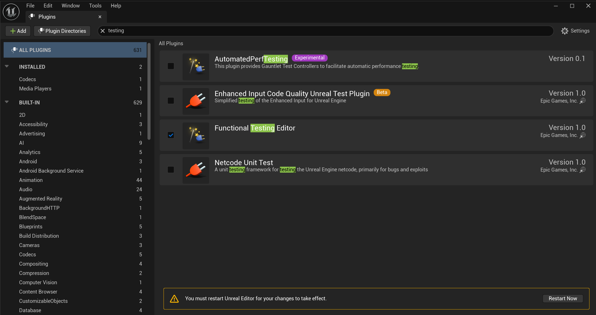
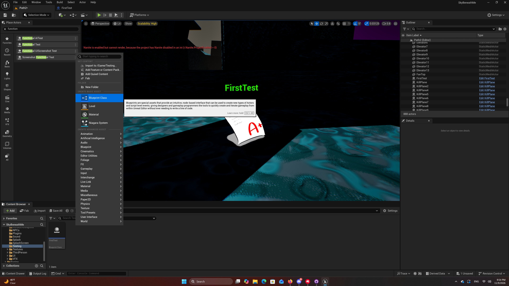
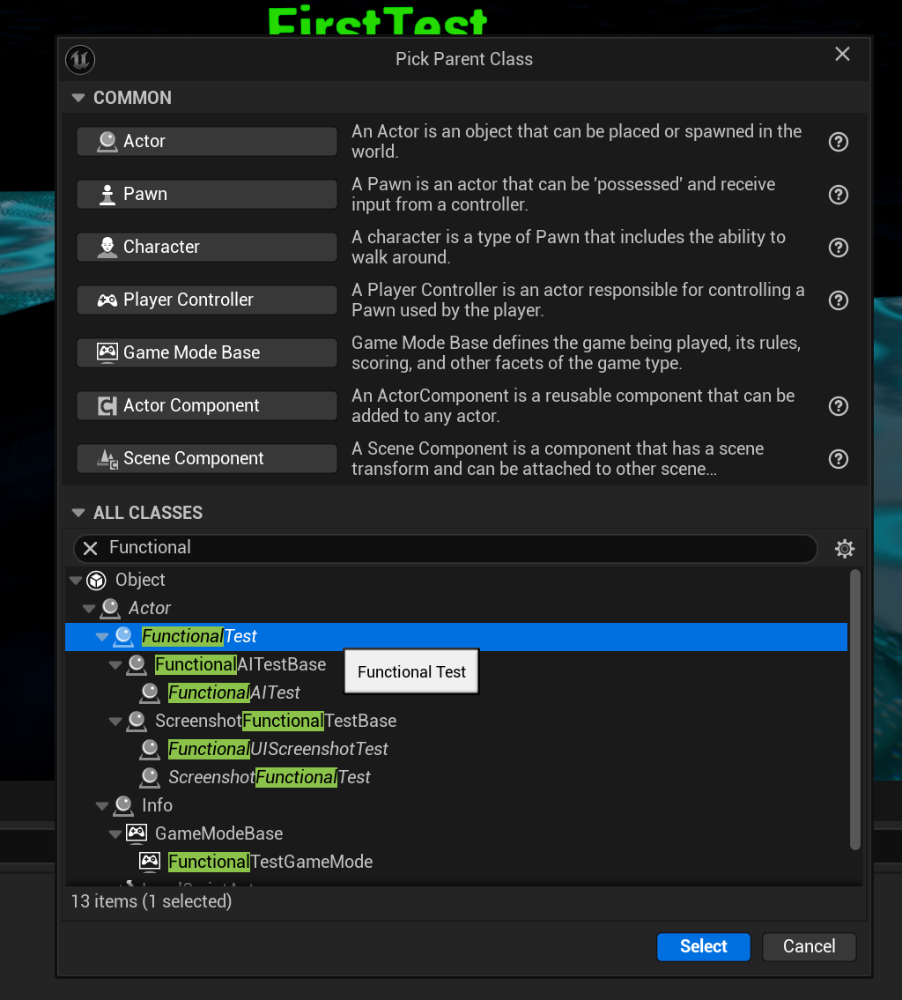
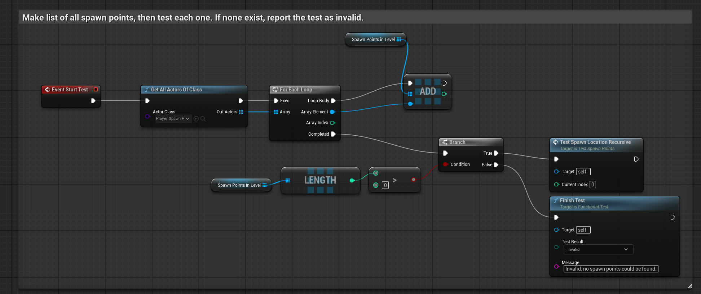
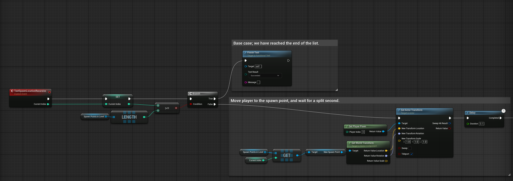
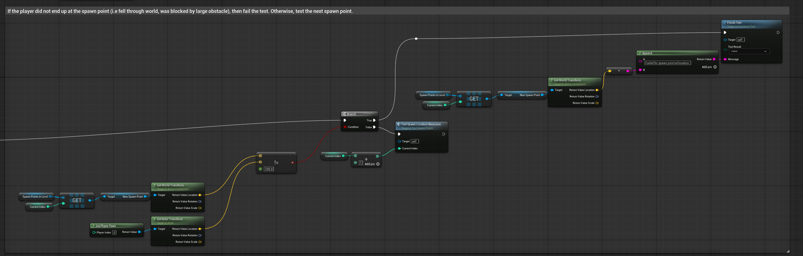
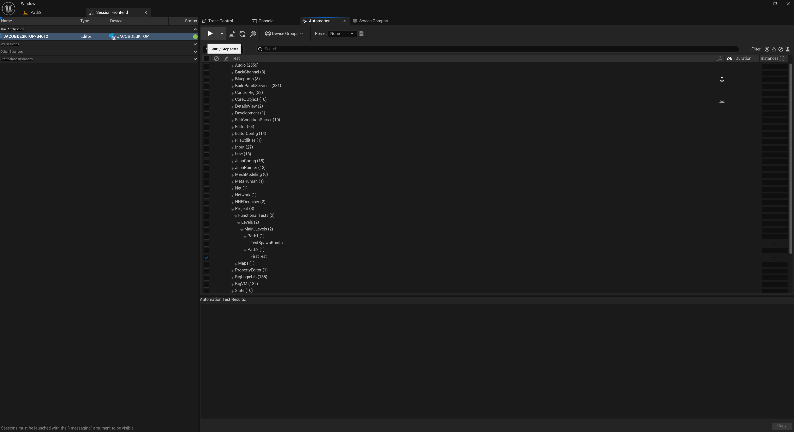
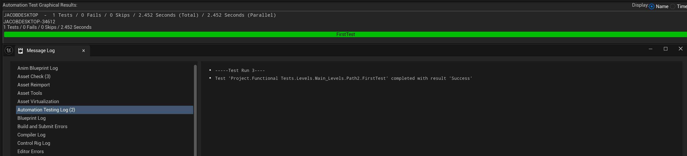

# Curiosity Report: Automated Testing in Unreal Engine

## Why I Was Curious About Automated Testing in Unreal Engine
To put it simply, I'm developing a game in Unreal Engine! Despite working with multiple people on it, automated testing has not come up yet. It sounds crazy, but testing has primarily been manual thus far. 

## What are the barriers to automated testing in video games?
Unlike other forms of software, video games are highly state-based and ran in real time. 
For example, in Unreal Engine, the way that physics behaves literally changes based on how fast the client machine runs. At 60fps, a ball can bounce on a wall, but at 15fps, it could go through the wall. But whether or not it goes through that wall will vary not only by the frame-rate, but also by where the ball was located. 
Thus, defining exact inputs and exact outputs for a video game can be tricky, let alone how to apply equivalence partitioning to those inputs.

## What would be a useful automated test for my game?
I am working on a single-player 3D platformer. The number of systems at play is relatively low, and the likelihood that a problem is caught with manual testing is very high. So, we want to automate things that we don't care to manually test. 
A prime example of this is respawn points; when the player dies, they are set back to a certain point of the level. The designer (me lol) can place a ton of these respawn points all over the level, and testing 20 respawn points manually does not sound like a fun afternoon. 
So it is decided: My goal is to automatically test every respawn point in a level!

## What did I do for research?
The research was relatively light. Before my experiment, I asked ChatGPT what options existed for Unreal Engine. It suggested Unreal Engine's built in 'Functional Tester'. 
I watched a youtube video about it (https://www.youtube.com/watch?v=vBsGMv2mUPA), and used what I learned from it to perform my experiment. 

## My Experiment

Firstly, I installed the official plugin for automated testing (I can't believe this is something that you have to opt into...)

Then, I created a new 'blueprint' (Unreal Engine's equivalent to a 'class') and made it a child of the 'FunctionalTest' blueprint.

Within this blueprint, I wrote a test that goes through every spawn point of a level. It required a bit of debugging, of course. Additionally, note that Unreal Engine has a form of low-code that serves as the primary form of code we use for this game. Although C++ is an option (I personally voted in favor of using c++), we use low-code because it makes it easier for the less technical members of the team to make changes (for example, when an engineer builds something, they may use a placeholder asset. Blueprints make it easier for the artist to go in and replace that placeholder with their own asset, and adjust settings such as location and scale).

Once the blueprint was made, I placed the test within the level I wanted it performed on, and then used the provided front-end to initiate the test. 

One thing I really appreciated about this testing suite was that the tests were done by running the actual game; it wasn't done in a vacuum, but rather while actually simulating the entire game. This personally raises my confidence in the test a lot. 

## What I learned
Obviously, I learned how to the official plugin for automated testing in Unreal Engine, which is a big win.
I was very surprised that the testing suite in Unreal Engine was a plugin that needed to be opted into. I can only guess why that is.
Unsurprisingly, writing tests isn't always too different from writing actual code. 

Additionally, after doing a bit of extra research (surface-level google searches and ChatGPT) I also learned currently, there is no in-engine support for mocks and spies! (Any that does exist is so buried that not even an LLM, a.k.a 'the ultimate webscraper', was aware of it).
I'm baffled to see this; is it really that hard to make a mock/spy? **This is a legitimate project for a future student/myself to take a look at!**
However, the state of the art for testing in Unreal Engine seems to be on par with expectations otherwise; the frontend plugin for testing is very comfortable and familiar to use. You write tests that perform actions, and then make assertions, and pass/fail (or declare invalid/error) based on those assertions. 
I am very glad to have learned how to use this. I can't promise I'm going to write an automated test for every single part of my game, but I can promise that it is a tool I am happy to have under my toolbelt.
